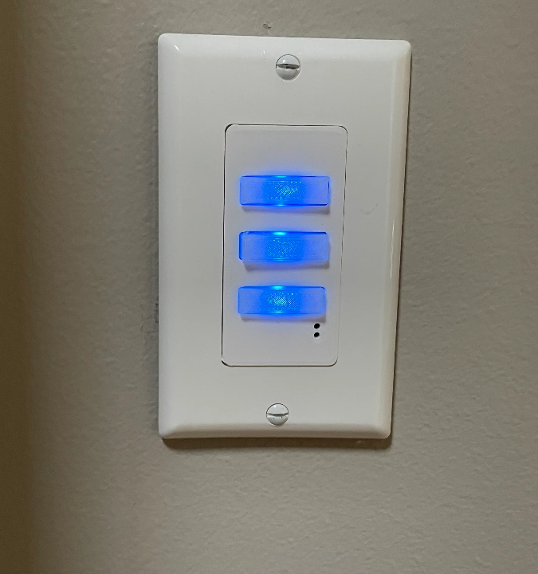
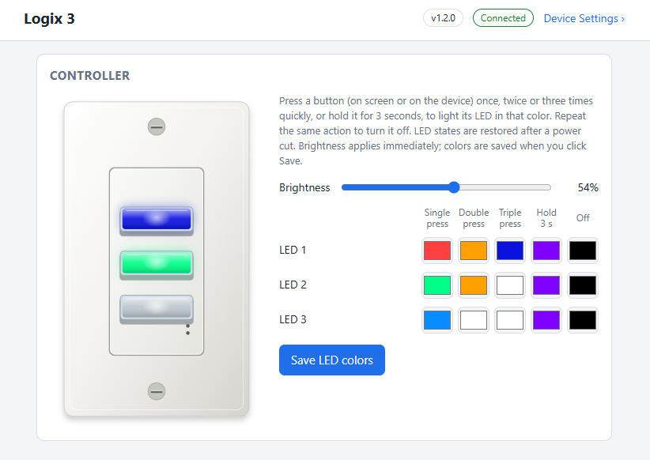
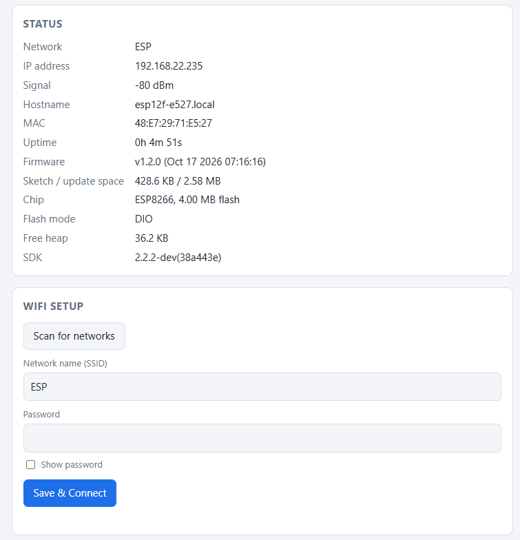
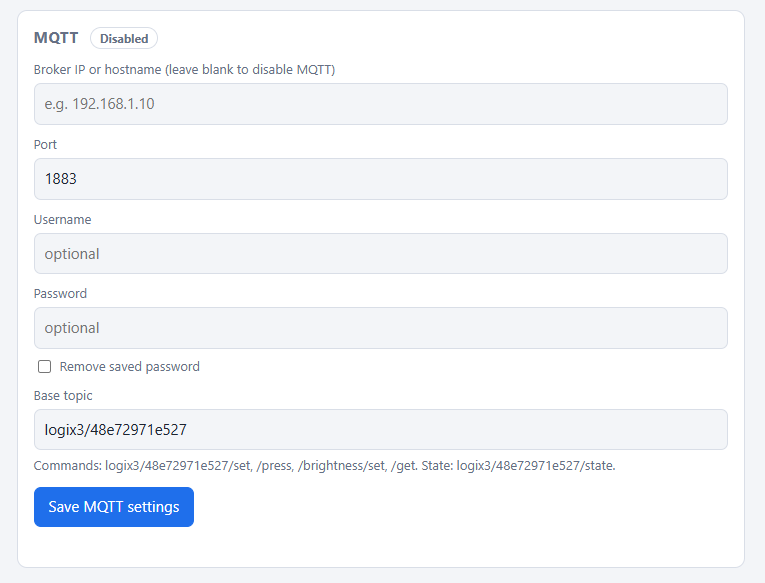
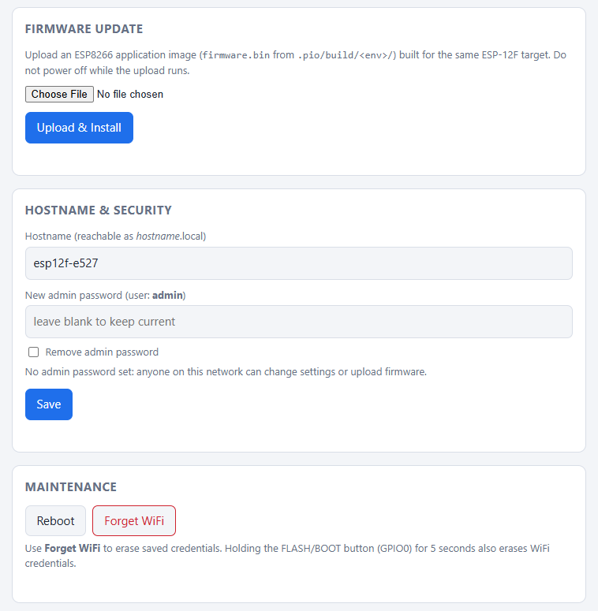

<p align="center">
  
</p>

<h1 align="center">Logix 3 Firmware</h1>

<p align="center">
  Firmware for a three-button RGB scene controller built on an ESP8266 (ESP-12F).<br>
  Each button has its own RGB LED. Buttons recognise single, double and triple presses and a 3-second hold.<br>
  Control it from its built-in web page, an HTTP API or MQTT.
</p>

<p align="center">
  
</p>

## Features

- **Four actions per button:** single, double and triple press, and a 3-second hold. Each action has its own LED color, plus an off color.
- **Saved across power cuts:** colors, brightness and the current state of every LED are stored in flash.
- **Web page:** a live on-screen copy of the controller, color pickers and a brightness slider. No app needed.
- **HTTP API and MQTT:** the same commands over both. The device publishes an event for every button action.
- **Built for integrations:** mDNS discovery (`_logix._tcp`), a public `/api/info` identity endpoint and MQTT discovery. A Home Assistant integration can find each device and recognise its model.
- **Self-contained setup:** a WiFi setup access point with a captive portal, firmware updates over the air from the web page, and an optional admin password.

## Web interface

### Controller

The main page shows the controller and nothing else. Tap the on-screen buttons the same way as the real ones (tap, double tap, triple tap or hold) and the LEDs follow. Set the four action colors and the off color for each LED, and the overall brightness.

<p align="center">
  
</p>

### Device settings

Everything else is on the **Device Settings** page, linked from the header.

| Status and WiFi | MQTT |
|---|---|
|  |  |
| Network, signal, firmware, memory and flash details. Scan for networks and join one. | Broker address, port, username, password and base topic, with the live connection status. |

<p align="center">
  <br>
  <em>Upload new firmware over the air, set the hostname and admin password, reboot or forget WiFi.</em>
</p>

## Hardware

| Function | GPIO |
|---|---|
| Button 1 / 2 / 3 (top to bottom) | 13 / 5 / 4. Active low: pressing pulls to GND; internal pull-ups enabled |
| RGB LEDs | 12. One WS2812 chain: pixel 0 is LED 1 (top), pixel 2 is LED 3 (bottom) |
| FLASH / BOOT button | 0. Hold 5 s to erase saved WiFi credentials |

The firmware targets an ESP-12F module with 4 MB flash.

## How the buttons work

| Action | Result |
|---|---|
| Press once | LED shows its **single press** color |
| Press twice quickly | LED shows its **double press** color |
| Press three times quickly | LED shows its **triple press** color |
| Hold for 3 seconds | LED shows its **hold** color, as soon as the 3 seconds are up |
| Repeat the same action | LED turns off and shows its **off** color (black by default, i.e. dark) |

Presses count as one sequence when they are no more than 400 ms apart. A single press therefore takes effect about 0.4 s after you let go, while the firmware waits for a possible second press.

## Getting started

### Build and flash

Requires [PlatformIO](https://platformio.org/).

```sh
pio run                 # build
pio run -t upload       # first flash over serial
pio device monitor      # serial log at 115200 baud
```

To put a bare module into download mode, hold GPIO0 low while resetting it. After the first flash, update over the air from **Device Settings → Firmware Update**, using `.pio/build/esp12f/firmware.bin`.

### Connect to WiFi

1. On first boot the device opens an open access point named `ESP12F-XXXX`.
2. Join it. The setup page opens automatically (captive portal), or browse to `http://192.168.4.1`.
3. Scan, pick your network, enter the password and press **Save & Connect**.
4. The device restarts and joins your network. It is then reachable at `http://esp12f-xxxx.local/` or its IP address.

If the network is unavailable for 5 minutes, the setup access point comes back automatically.

## API and MQTT

Full reference: **[API.md](API.md)**. In short:

| HTTP | MQTT (base topic `logix3/<id>`) | Purpose |
|---|---|---|
| `GET /api/controller` | `…/state` (retained) | Button and LED state, colors, brightness |
| `POST /api/controller` | `…/set` (JSON) | Set any colors, LED states or brightness |
| `POST /api/controller/press` | `…/press` (JSON) | Simulate a single, double or triple press, or a hold |
| `POST /api/controller/brightness` | `…/brightness/set` | Set brightness (0-255) |
| | `…/button/N/action` | Event for every completed button action |
| `GET /api/info` | `logix/discovery/<id>` (retained) | Identity and capabilities for integrations |

```sh
# LED 2 on in its double press color, at half brightness
curl -X POST -d "led2State=double&brightness=128" http://esp12f-xxxx.local/api/controller

# The same over MQTT
mosquitto_pub -h <broker> -t logix3/<id>/set -m '{"led2State":"double","brightness":128}'
```

### Integrations

Each device advertises `_logix._tcp.local.` with TXT records `model`, `id`, `fw`, `api` and `manufacturer`. It also serves `GET /api/info` without a password. An integration can use `model` to choose device-specific behaviour, and `id` (the MAC address) as the unique ID. See [Identifying the device](API.md#identifying-the-device).

## Security

With no admin password set, anyone on your network can change settings or upload firmware. Set one under **Device Settings → Hostname & Security** on installed units. The web page, API and firmware upload then require HTTP Basic auth as user `admin`. `/api/info` stays open so discovery keeps working.

## Project layout

```
src/
  main.cpp            setup, HTTP routes, device identity
  controller.*        buttons, LEDs, multi-press and hold detection, saved settings
  mqtt.*              MQTT client, command topics, MQTT settings
  settings_file.h     checksummed settings files in LittleFS
lib/BaseCore/         WiFi, captive portal, web page, firmware update, mDNS, /api/info
API.md                HTTP and MQTT reference
```

`lib/BaseCore` is model-independent. Other Logix devices can reuse it by setting `model`, `title` and `infoExtra` in `BaseConfig`.
